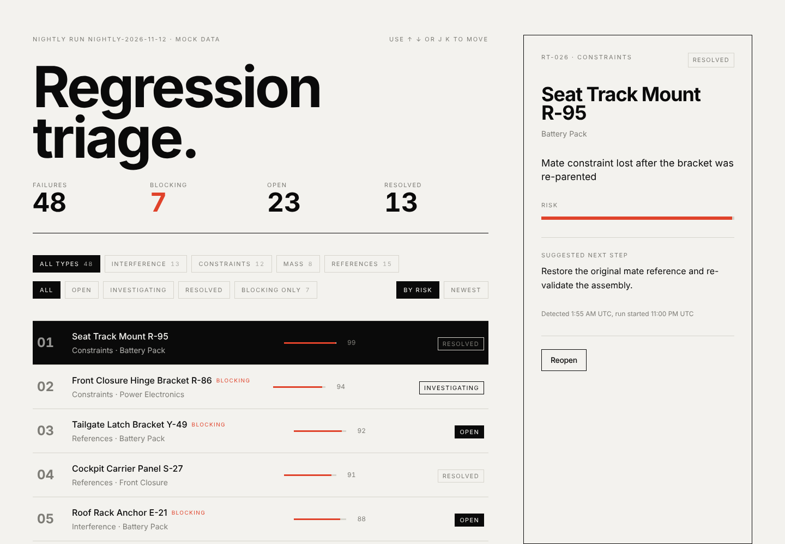
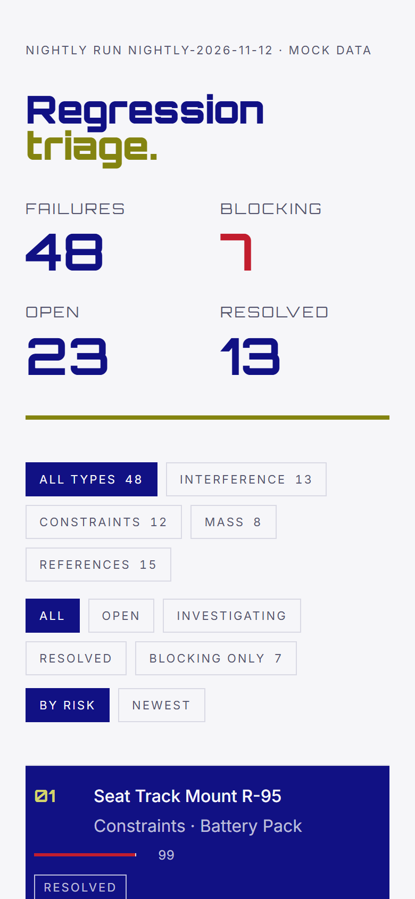
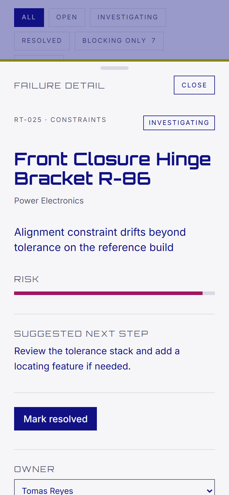

# Regression triage

A prototype for an engineer checks a regression run and decides which failures block the next design release.



## What this is

Every night, an automated regression run checks a vehicle design model for problems: parts that collide, constraints that broke, mass over budget, links to outdated parts. A run can produce dozens of failures. Most are noise or already known. A few block the next design release, and someone has to find them before the morning review.

This prototype is for the design engineer who does that first pass. Version 1 ranks failures by risk, filters them by error type, status, and owner, and flags the ones that block a release. For each failure it shows a suggested next step, a status history, and a note field, and the engineer can assign it, set a due date, and move it to investigating or resolved. Engineers can switch between the last three nightly runs, share a filtered view by URL, and jump anywhere with Ctrl+K.

Out of scope on purpose: real authentication, a real API, editing the design model, notifications, and syncing notes between devices. **All data is mock.** Part names, assemblies, engineers, and run IDs are invented, and nothing comes from a real vehicle program or internal system.

## Why it's built this way

- **Pure functions for triage logic.** Filtering, sorting, bucketing, and the "blocking" and "overdue" rules live in `src/lib/` with no React, so they are easy to test and reuse.
- **Server state and UI state are separate.** TanStack Query owns failure data. Zustand owns what the user is looking at. Neither one copies the other.
- **The store is the source of truth, and the URL mirrors it.** Components never read the URL. A small sync module keeps the two in step, so views can be shared without URL logic spreading through the app.
- **Optimistic updates with rollback.** A change shows at once, because waiting on a slow nightly-run service would break the flow of triage.
- **Seeded mock data.** The same seed always gives the same run, so tests and screenshots are stable.
- **Tokens as the source of truth.** Colors, fonts, and the type scale live in `tokens.json`, with a test that keeps the CSS in sync and a script that checks contrast.
- **Keyboard first.** Engineers triage dozens of rows, so J, K, the arrow keys, and a command palette cover the main paths.
- **No chart library.** Two small charts do not justify a dependency, and plain SVG makes the accessible version easy to control.

## Controls

- Click a row, or use the arrow keys or J and K, to move through the list.
- Ctrl+K (Cmd+K on a Mac) opens the command palette: jump to a failure, change a filter, or switch runs.
- "Blocking only" shows high-risk failures that are not resolved. "Mine" shows failures assigned to the current user (Ines Okafor, set in `src/data/team.ts`).
- On screens narrower than 1024px, the detail opens in a bottom sheet. Drag the handle down or press Escape to close it.

## Design

### Surface

**Paper background, navy type, olive accents.** This is a reading tool. An engineer scans 48 rows, compares risk bars, and reads suggested actions, so the bulk of the screen has to be comfortable for small text. Navy on paper is 13.55:1, and the three risk colors all pass 4.5:1 on paper, so they can label text, not just fill bars. A navy background would put the risk colors and olive on a dark surface where they lose contrast (olive on navy is under 4.5:1), and it would make the dense list heavier to read. Olive measures 3.68:1 on paper, so it only appears at display size ("triage." in the header), as fills (the rule under the header), and as the focus ring. On navy surfaces, such as the selected row, a lighter olive (`accent-soft`, 9.34:1) takes its place.

### Palette

| Token | Value | Use |
| --- | --- | --- |
| `primary` | `#111184` | Brand navy. Text, display type, solid surfaces, borders |
| `accent` | `#848411` | Brand olive. Display text 24px and up, fills, focus ring. Never small text |
| `accent-soft` | `#d4d46a` | Olive for small accents and focus on navy surfaces |
| `paper` | `#f6f6f9` | Page background |
| `muted` | `#55556e` | Secondary text and labels |
| `line` | `#d9d9e4` | Hairlines and bar tracks (decorative) |
| `risk.high` | `#a3165f` | Risk 70 and up. Raspberry |
| `risk.mid` | `#b05a00` | Risk 40 to 69. Burnt orange |
| `risk.low` | `#00789c` | Risk under 40. Teal |

The risk colors are kept away from olive in hue, as the brief asked. They were also run through a color-blindness check for the charts: the first set (crimson, amber-orange, green-teal) put high and mid risk only ΔE 2.7 apart for deuteranopia, which reads as the same color. The final set is ΔE 14.5 apart for deuteranopia and 18.3 apart for normal vision. Risk is never shown by color alone: rows show the score, and blocking failures carry a "Blocking" label.

Contrast, from `npm run contrast` (20 of 20 pairs pass):

| Foreground | Background | Kind | Ratio | Needs |
| --- | --- | --- | --- | --- |
| primary | paper | text | 13.55:1 | 4.5:1 |
| muted | paper | text | 6.69:1 | 4.5:1 |
| accent | paper | large text | 3.68:1 | 3:1 |
| accent | paper | UI (focus ring, fills) | 3.68:1 | 3:1 |
| paper | primary | text | 13.55:1 | 4.5:1 |
| paper at 75% | primary | text | 7.99:1 | 4.5:1 |
| accent-soft | primary | text and UI | 9.34:1 | 4.5:1 |
| paper | accent | large text | 3.68:1 | 3:1 |
| risk.high | paper | text and UI | 6.86:1 | 4.5:1 |
| risk.mid | paper | text and UI | 4.52:1 | 4.5:1 |
| risk.low | paper | text and UI | 4.67:1 | 4.5:1 |
| risk.high | line (track) | UI | 5.29:1 | 3:1 |
| risk.mid | line (track) | UI | 3.48:1 | 3:1 |
| risk.low | line (track) | UI | 3.60:1 | 3:1 |
| paper | risk.high | text (Overdue badge) | 6.86:1 | 4.5:1 |

### Type scale

Orbitron (400, 700, 900) for display, Inter (400, 500) for everything else. Both are bundled from `@fontsource`, Latin subset only, so the app makes no font requests at runtime. Orbitron is wide and hard to read small, so it never goes below 14px and is never used for paragraphs.

| Token | Size | Font | Use |
| --- | --- | --- | --- |
| `display-xl` | 36px to 88px (fluid) | Orbitron 900 | Header title |
| `stat` | 48px | Orbitron 700 | Header numbers |
| `display-md` | 30px | Orbitron 700 | Detail title, empty and error headings |
| `display-sm` | 24px | Orbitron 700 | List numbers, section headings |
| `label` | 14px | Orbitron 400, uppercase | Section labels. The Orbitron floor |
| `body-lg` | 18px | Inter 400 | Failure summary |
| `body` | 16px | Inter 400 / 500 | Body copy, row titles |
| `body-sm` | 14px | Inter 400 | Secondary text, buttons, form controls |
| `caption` | 12px | Inter 400 | Timestamps, risk numbers |
| `micro` | 11px | Inter 400, uppercase | Chips, status pills, metadata |

The Orbitron spec link (figma.com/fonts/orbitron) could not be fetched while planning. `@fontsource/orbitron` is the same open-source family.

## Architecture

```
URL query string  <── urlSync.ts ──>  triageStore (Zustand)   view: run, filters, sort, mine, selection
                                            │
                                            ▼ runId
                                   TanStack Query  ['failures', runId]  ──>  mock API (src/api/failures.ts)
                                            │                                     │ localStorage
                                            ▼                                     ▼
                                     App: filter + sort  ──>  list, charts, detail, palette
                                            │
                                            ▼
                                   notesStore (Zustand persist)   history and notes per runId/failureId
```

**View store** (`src/store/triageStore.ts`). Holds what the user is looking at: run, group, status, sort, blocking only, mine, and the selected failure. It is not persisted, because the URL already carries it. `setRun` clears the selection, since failure IDs belong to a run.

**URL sync** (`src/store/urlSync.ts`). `startUrlSync()` runs once in `main.tsx` before the first render, so a shared link opens the right view before anything auto-selects. It reads the query string into the store, writes store changes back, and applies the URL again on Back and Forward. Filter, sort, and run changes push a history entry, so Back undoes them. Selection changes replace the entry, so moving with J and K does not fill the history. Defaults are left out of the URL, and invalid values fall back to defaults. Example: `?run=NIGHTLY-2026-11-10&group=Mass&blocking=1&id=RT-015`.

**Query layer** (`src/api/`). `useFailures(runId)` caches each run under `['failures', runId]`. `useUpdateFailure()` changes status, owner, or due date with an optimistic update: it patches the cache at once, rolls back on error, and refetches when it settles. Only a confirmed status change is written to the history. The mock API is the only file to replace for a real backend. It saves changes to localStorage so a reload behaves like a server.

**Notes store** (`src/store/notesStore.ts`). Status history and notes, persisted with Zustand's `persist` middleware under `regression-triage:notes`, version 2, keyed `runId/failureId`. `migrateNotes` upgrades version 1 data (notes and history keyed by failure ID alone, history with only the new status) and drops data from unknown versions.

**Other pieces.** `useDetailLayout` picks side panel, bottom sheet, or inline panel from the viewport and `prefers-reduced-motion`. Each region (list and detail) has its own error boundary and recovery action. `MotionConfig reducedMotion="user"` makes Motion honor the OS setting.

## Structure

- `src/api/`: mock API and query hooks
- `src/data/`: seeded run generator, runs, and the fictional team
- `src/lib/`: pure triage logic, dates, labels, command search, and sheet thresholds (all unit tested)
- `src/store/`: view store, URL sync, and the persisted notes store
- `src/hooks/`: media query and detail layout
- `src/components/`: header, run switcher, charts, filters, list, detail panel and sheet, command palette, About panel, states
- `src/styles/tokens.json`: design tokens
- `scripts/`: contrast check, test launcher, README page, screenshots, story accessibility check
- `e2e/`: Playwright tests, including axe checks
- `.storybook/` and `*.stories.tsx`: Storybook

## Testing

- **Unit and component (Vitest):** 99 tests across triage logic, tokens, the stores, URL sync, persistence and migration, charts, the command palette, the bottom sheet, error boundaries, and the main app flows.
- **End to end (Playwright, Chromium):** 17 tests covering triage, URL sync, the run switcher, the command palette, and the 390px bottom sheet (tap, drag to close, short drag snaps back, Escape, the reduced-motion fallback). Stable over three repeated runs.
- **Accessibility:** axe runs in e2e on the main view, the detail panel, the open command palette, and the mobile sheet, and fails on any serious or critical violation. None were found, at any severity. `npm run test:stories` runs axe on all 18 stories, and all pass. `npm run contrast` checks the palette.

 

## Known limits

- **Mock backend only.** No real API or auth. Notes, history, and status changes live in this browser's localStorage and do not sync between devices or people.
- **The version 1 notes format is invented.** Version 2 is the first version this app ever stored. Version 1 is a plausible earlier shape, written so the migration path is real and tested.
- **"Overdue" uses the real clock.** Seeded due dates fall around November 12, 2026, so the further today is from that date, the more seeded failures show as overdue.
- **Charts show the whole run**, not the filtered list.
- **The About panel links to a generated `readme.html`**, built from this file, rather than to a repository URL, because there is no public repo yet.
- **Not verified:** a manual screen reader pass (NVDA, VoiceOver), Firefox and Safari (e2e runs in Chromium only), and drag-to-close on a real touch device (tested with emulated pointer drags in Chromium).
- **No dark mode.**
- **The Storybook test addon is not installed**, to keep `npm test` on its current Vitest setup. Story accessibility is checked with `npm run test:stories` instead. Storybook's own build prints a chunk-size warning for its bundled axe and docs code. The app build does not.
- **Running Vitest or Storybook with `npx` from a terminal that reports a lowercase drive letter still fails.** Use the npm scripts.
- **Style Dictionary is not set up.** `tokens.json` and the `@theme` block are kept in sync by hand, guarded by `src/styles/tokens.test.ts`.
